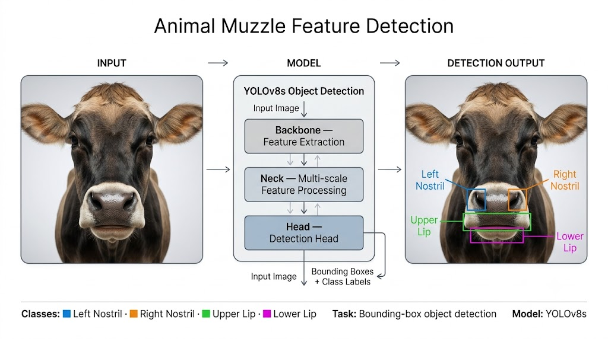
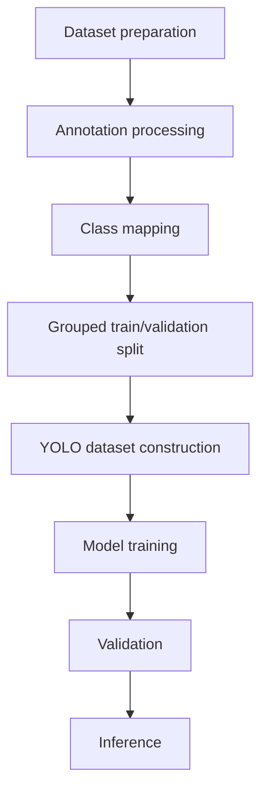

<div align="center">

# Animal Muzzle Region Detection

Object detection of four muzzle regions (left nostril, right nostril, upper lip, lower lip) using YOLOv8.


[](https://colab.research.google.com/)

</div>



*Figure 1. Illustrative overview of the detection workflow. The bounding boxes shown are schematic and do not represent measured model output.*

## Table of Contents

1. [Overview](#overview)
2. [Approach](#approach)
3. [Dataset](#dataset)
4. [Model](#model)
5. [Results](#results)
6. [Usage](#usage)
7. [Project Structure](#project-structure)
8. [Limitations and Scope](#limitations-and-scope)
9. [Future Work](#future-work)
10. [License](#license)

## Overview

This project applies YOLO-based object detection to localize regions of the animal muzzle with bounding boxes. The model predicts four classes: left nostril, right nostril, upper lip, and lower lip. The implementation is a single Jupyter notebook covering the full workflow, from dataset preparation to inference.

Class names refer to the animal's own left and right, not the viewer's. Annotations, figures, and downstream use should follow this convention consistently.

## Approach



| Stage | Description |
|---|---|
| Dataset preparation | An archive of images and bounding-box labels is extracted, and the `images` and `boxes` directories are located by name. |
| Annotation processing | Images and label files are paired by filename stem. Unpaired files are excluded. |
| Class mapping | The `muzzle` class in the source annotations is dropped, and the remaining classes are remapped to indices 0 to 3. |
| Grouped split | Frames are grouped by source video before splitting, so no video contributes frames to both sets. The split is deterministic for a fixed seed (42) and split ratio (0.85). |
| Dataset construction | Images and remapped labels are written to a YOLO-format directory with a `data.yaml` file. |
| Training, validation, inference | Performed with Ultralytics. |

## Dataset

The source annotations are CVAT-style bounding boxes exported as YOLO text files. The images are frames extracted from short videos. Because consecutive frames are nearly identical, a random frame-level split would place near-duplicates in both the training and validation sets. The split is therefore grouped by source video.

Exact dataset sizes are withheld.

| Statistic | Value |
|---|---|
| Source videos or samples | X |
| Matched image-label pairs | X |
| Training images | X |
| Validation images | X |
| Validation instances | X |

The dataset is not included in this repository.

## Model

| Setting | Value |
|---|---|
| Architecture | `yolov8s` (Ultralytics 8.4.138) |
| Initialization | Pretrained `yolov8s.pt`, 4 classes |
| Image size | 640 |
| Batch size | 16 |
| Optimizer | AdamW |
| Maximum epochs | 150 |
| Early stopping patience | 30 |
| Horizontal flip (`fliplr`) | 0.5 |
| Other hyperparameters | Ultralytics defaults |

Training was performed on a GPU in Google Colab. In the recorded run, early stopping ended training after 76 epochs, and the best epoch was 46.

## Results

Metrics were computed by Ultralytics on the validation split using the best checkpoint from the recorded training run.

**Overall**

| Metric | Value |
|---|---:|
| Precision | 0.872 |
| Recall | 0.870 |
| mAP50 | 0.918 |
| mAP50-95 | 0.621 |

**Per class**

| Class | Precision | Recall | mAP50 | mAP50-95 |
|---|---:|---:|---:|---:|
| Left nostril | 0.807 | 0.775 | 0.859 | 0.554 |
| Right nostril | 0.778 | 0.785 | 0.846 | 0.546 |
| Upper lip | 0.968 | 0.975 | 0.988 | 0.700 |
| Lower lip | 0.935 | 0.943 | 0.981 | 0.682 |

The nostril classes score lower than the lip classes. The cause has not been investigated; see [Limitations and Scope](#limitations-and-scope) for one factor that may contribute.

## Usage

1. Install the dependencies.
   ```bash
   pip install -r requirements.txt
   ```
   In Google Colab, PyTorch is preinstalled, and the notebook installs the pinned Ultralytics version.
2. Open `notebooks/muzzle_region_detection_yolov8.ipynb` in Jupyter or Google Colab. A CUDA-capable GPU is required for training.
3. To reproduce training, provide a dataset as a zip archive containing two directories:
   - `images`: `.jpg`, `.jpeg`, or `.png` frames.
   - `boxes`: one YOLO-format `.txt` label file per image, with a matching filename stem. Source class indices are 0 left nostril, 1 right nostril, 2 muzzle, 3 upper lip, 4 lower lip.
4. Set `DATASET_ARCHIVE_PATH` and the other paths in the configuration cell, then run the cells in order.
5. For inference, set `NEW_IMAGE_PATH` in the final cell to the path of your own image.

### Standalone inference

With trained weights available as `best.pt`:

```python
from ultralytics import YOLO

model = YOLO("best.pt")
results = model.predict("path/to/image.jpg", imgsz=640, conf=0.25)

# Save an annotated copy of the image
results[0].save(filename="prediction.jpg")

# Print detections
for box in results[0].boxes:
    name = results[0].names[int(box.cls)]
    print(name, round(float(box.conf), 3), box.xyxy[0].tolist())
```

## Project Structure

```text
.
├── assets/
│   └── workflow.png
├── notebooks/
│   └── muzzle_region_detection_yolov8.ipynb
├── requirements.txt
├── LICENSE
└── README.md
```

The dataset and trained weights are not part of the repository.

## Limitations and Scope

- The dataset, annotations, and trained weights are not included. The training and validation cells cannot be run without user-supplied data.
- The reported results come from a single recorded validation run. The same validation split was used for early stopping and checkpoint selection, and no separate held-out test set was evaluated.
- Horizontal flip augmentation was enabled (`fliplr=0.5`). Flipping interchanges the apparent sides of the nostrils, which may cause confusion between the left and right nostril classes. No ablation was performed to measure this effect.
- Figure 1 is illustrative and does not show measured detections.

## Future Work

- Evaluate on a held-out test set separate from the validation split.
- Train with `fliplr=0.0` and compare left and right nostril metrics against the current run.
- Extend the data to additional species and lighting conditions.
- Add a demonstration application for uploading an image and viewing detections.
- Include a real prediction example generated from the trained model.

## License

Specify the project license here and add the corresponding `LICENSE` file to the repository root. Note that Ultralytics YOLO is distributed under AGPL-3.0, which may affect licensing of derived work.